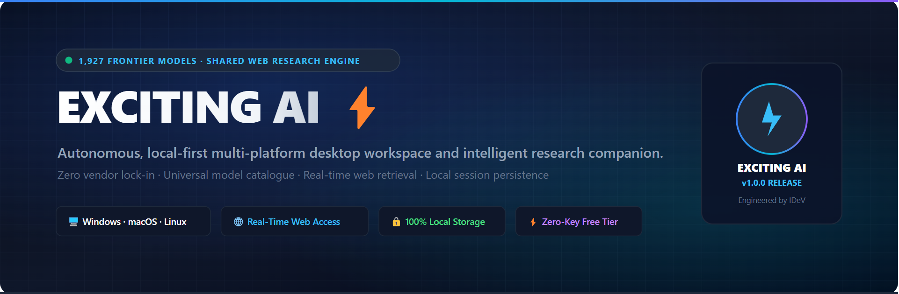
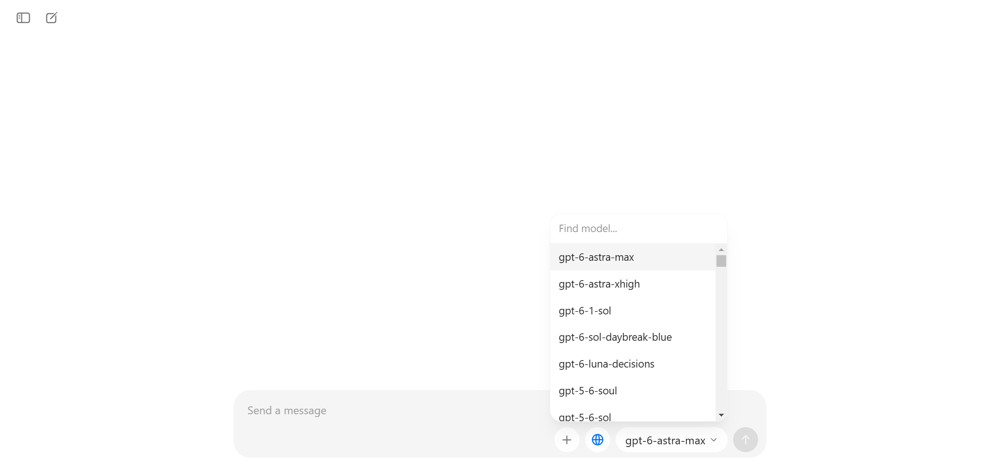
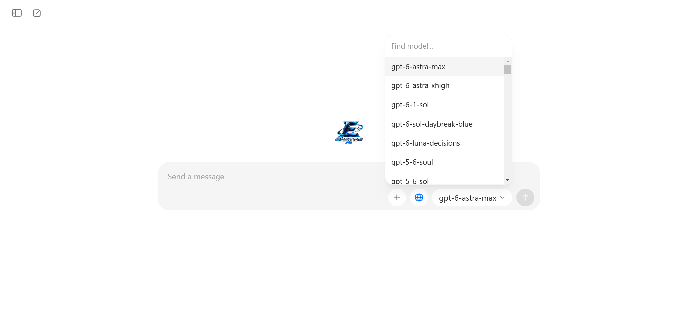

<p align="center">
  
</p>

<p align="center">
  
</p>

<h1 align="center">Exciting AI ⚡</h1>

<p align="center">
  <strong>Autonomous Multi-Platform AI Desktop Workspace · 1,927 Universal Frontier Models · Shared Real-Time Web Research Engine</strong>
</p>

<p align="center">
  <a href="https://github.com/musawir-13/Exciting-AI/releases/latest/download/Exciting-AI-Windows-Setup-x64-1.0.0.exe">
    
  </a>
  <a href="https://github.com/musawir-13/Exciting-AI/releases/latest">
    
  </a>
</p>

<p align="center">
  
  
  
  
  
  
</p>

<p align="center">
  <a href="#overview">Overview</a> •
  <a href="#product-showcase">Showcase</a> •
  <a href="#core-features">Features</a> •
  <a href="#1927-model-universal-catalogue">Model Catalogue</a> •
  <a href="#shared-web-research-engine">Web Access</a> •
  <a href="#download-exciting-ai">Download</a> •
  <a href="#installation--getting-started">Installation</a> •
  <a href="#automated-master-test-suite">Testing</a> •
  <a href="#security--privacy-architecture">Security</a> •
  <a href="#authorship--company-identity">Credits</a>
</p>

---

## Overview

**Exciting AI** is an autonomous, local-first artificial intelligence desktop workspace and research environment developed by **IDeV**, created by developer **Ubaid**.

Most existing AI desktop applications are walled gardens: they bind you to a single proprietary provider, force account registrations, inject canned greetings, and lock chat histories behind cloud synchronization. 

**Exciting AI takes the opposite approach.** It places **1,927 frontier AI models** and an application-level **Web Research Engine** directly onto your personal device with zero vendor lock-in, zero mandatory cloud subscriptions, and complete offline persistence of your private conversations.

Whether you are writing software, synthesizing research across multiple AI labs, exploring multimodal image inputs, or performing real-time public web verification, Exciting AI provides a unified, responsive canvas built for speed, transparency, and deep privacy.

---

## Product Showcase

### 1. Unified Desktop Canvas
A clean, distraction-free desktop interface built for intensive reasoning, code authoring, and multi-turn problem solving.

<p align="center">
  
  <br />
  <em>Exciting AI Main Workspace — Clean conversational canvas with model selector, multi-attachment support, and quick access.</em>
</p>

---

### 2. Intelligent Chat & Dynamic Model Sync
Engage in rich, multi-turn conversations with true model identity synchronization. The selected model dynamically reflects its actual architecture and provider context without synthetic text boilerplate.

<p align="center">
  
  <br />
  <em>Intelligent Chat & Dynamic Model Sync — Seamless conversation with GPT-6.1 Sol from OpenAI, real-time reasoning tokens, and zero synthetic boilerplate.</em>
</p>

---

### 3. Universal 1,927-Model Catalogue
Browse, filter, and switch between 1,927 curated frontier models across OpenAI, Anthropic, Google DeepMind, Meta, DeepSeek, xAI, Mistral, Alibaba, and leading research labs in a single click.

<p align="center">
  
  <br />
  <em>1,927 Model Catalogue — Direct access to models across OpenAI, Anthropic, Google DeepMind, Meta, DeepSeek, xAI, Mistral, and more.</em>
</p>

---

### 4. Shared Real-Time Web Research Engine
Activate the globe-shaped Web Access toggle to grant *any* of the 1,927 models live internet research capabilities. Exciting AI queries public sources, synthesizes relevant findings, and provides clickable Markdown citations.

<p align="center">
  
  <br />
  <em>Shared Real-Time Web Access — Instant public web retrieval, automated source synthesis, SSRF protection, and clickable Markdown citations.</em>
</p>

---

### 5. Algorithmic Reasoning & Code Synthesis
Deep technical answers rendered with syntax-highlighted code fences, copy shortcuts, and transparent step-by-step reasoning tokens.

<p align="center">
  
  <br />
  <em>Algorithmic Reasoning & Code Synthesis — Clean multi-language syntax highlighting, copy-ready blocks, and structured thoughts.</em>
</p>

---

## Core Features

| Feature | User Benefit | Technical Implementation |
| :--- | :--- | :--- |
| **1,927 Universal Models** | Switch freely between frontier reasoning, coding, and lightweight models without managing separate accounts. | Curated local registry with dynamic metadata descriptors and parameter mapping. |
| **Shared Web Research Engine** | Real-time internet access available to *every* model family via a single globe toggle in the chat composer. | Provider-independent search pipeline with SSRF filtering, text extraction, and Markdown link citations. |
| **100% Local-First Storage** | Complete confidentiality for your conversations, prompts, code snippets, and personalized settings. | Stored strictly in local JSON disk stores (`Storage/chats/`) with zero cloud telemetry. |
| **Multi-Platform Native Support** | Run natively on Windows, macOS, Linux, Android devices, or in modern web browsers. | Electron desktop runtime, responsive Tailwind/Vite SPA bundle, Android Studio wrapper, and Node.js web server. |
| **Multi-Format Attachment Engine** | Upload and analyze images, design screenshots, code files, and structured logs. | Native support for PNG, JPG, WEBP, GIF, SVG, BMP, ICO, TS, JS, PY, JSON, and Markdown. |
| **Zero-Key Free Tier** | Start conversing and researching immediately upon installation without requiring an upfront API credit balance. | Integrated high-speed free tier with transparent optional custom API key configuration. |

---

## 1,927-Model Universal Catalogue

Exciting AI includes a fully integrated catalogue of **1,927 unique models** across premier AI organizations:

| Provider / Organization | Flagship Models Included | Supported Modalities |
| :--- | :--- | :--- |
| **OpenAI** | `gpt-6-1-sol`, `gpt-6-astra-max`, `gpt-5-turbo`, `o3-mini`, `o1-preview` | Reasoning, Vision, Code, Text |
| **Anthropic** | `claude-3-7-sonnet`, `claude-3-5-sonnet`, `claude-3-5-haiku`, `claude-opus-4-8` | Extended Thinking, Analysis, Code |
| **Google DeepMind** | `gemini-2.5-pro`, `gemini-2.5-flash`, `gemini-2.0-flash-thinking`, `gemma-2-27b` | Multimodal Synthesis, Ultra-Long Context |
| **Meta AI** | `llama-3.3-70b`, `llama-3.2-vision`, `llama-3.1-405b`, `codellama-70b` | General Intelligence, Code Generation |
| **DeepSeek** | `deepseek-r1`, `deepseek-v3`, `deepseek-coder-v2` | Mathematical Proof, Algorithmic Reasoning |
| **xAI** | `grok-4.7`, `grok-beta`, `grok-2-vision` | Real-Time Knowledge, Frontier Reasoning |
| **Mistral AI** | `mistral-large-2411`, `pixtral-12b`, `codestral-2501` | Multilingual, Dense Coding, Vision |
| **Open Communities** | Qwen 2.5, Yi, Gemma, Solar, Starcoder, Command R+ | Local / Edge Inference, Specialized Tasks |

---

## Shared Web Research Engine

The globe-shaped **Web Access** button next to the input box empowers all models with internet research:

```
[User Query] ──► [Globe Active?]
                       │
             ┌─────────┴─────────┐
             ▼ (Yes)             ▼ (No)
   [SSRF Defense Check]    [Direct Context Inference]
             │                   │
   [Multi-Source Search]         │
             │                   │
   [Readable Text Extraction]    │
             │                   │
   [Isolated Citation Block]     │
             │                   │
             └─────────┬─────────┘
                       ▼
         [Grounding Model Generation]
                       │
                       ▼
      [Answer + Clickable Source Links]
```

- **Universal Accessibility:** Works identically whether using OpenAI, Anthropic, Google DeepMind, Meta, DeepSeek, or open models.
- **SSRF Defense:** Prevents Server-Side Request Forgery by blocking loopback (`127.0.0.1`), RFC 1918 private subnets, link-local metadata, and non-HTTP protocols.
- **Untrusted Content Framing:** External web pages are enclosed inside strict non-executable citation blocks to protect against prompt injection.
- **Zero-Waste Inactive State:** Turning off the globe toggle skips external network calls completely, maintaining instant local context responses.

---

## Download Exciting AI

Download pre-built binary distributions directly from the [Latest Release](https://github.com/musawir-13/Exciting-AI/releases/latest):

| Platform | Architecture | Package Format | Download Link | Build Status |
| :--- | :--- | :--- | :--- | :---: |
| **Windows 10 / 11** | x64 (Intel / AMD) | NSIS Setup (`.exe`) | [Exciting-AI-Windows-Setup-x64-1.0.0.exe](https://github.com/musawir-13/Exciting-AI/releases/latest/download/Exciting-AI-Windows-Setup-x64-1.0.0.exe) | :white_check_mark: Verified |
| **Windows 10 / 11** | x64 (Intel / AMD) | Portable (`.exe`) | [Exciting-AI-Windows-Portable-x64-1.0.0.exe](https://github.com/musawir-13/Exciting-AI/releases/latest/download/Exciting-AI-Windows-Portable-x64-1.0.0.exe) | :white_check_mark: Verified |
| **Windows 10 / 11** | ARM64 | NSIS Setup (`.exe`) | [Exciting-AI-Windows-Setup-arm64-1.0.0.exe](https://github.com/musawir-13/Exciting-AI/releases/latest/download/Exciting-AI-Windows-Setup-arm64-1.0.0.exe) | :white_check_mark: Verified |
| **macOS** | Apple Silicon & Intel | DMG Package (`.dmg`) | [GitHub Releases](https://github.com/musawir-13/Exciting-AI/releases/latest) | :hammer_and_wrench: CI Matrix |
| **Linux** | x64 / ARM64 | AppImage, DEB, RPM | [GitHub Releases](https://github.com/musawir-13/Exciting-AI/releases/latest) | :hammer_and_wrench: CI Matrix |
| **Android** | ARM64 / universal | Android Project & APK | [release/android/](release/android/) | :white_check_mark: Staged |
| **Web Browser** | Any Modern Browser | Standalone Web Edition | Run `npm run start:web` | :white_check_mark: Verified |

---

### Package Verification (SHA-256)

Verify the integrity and authenticity of downloaded Windows installers using PowerShell:

```powershell
Get-FileHash -Algorithm SHA256 .\Exciting-AI-Windows-Setup-x64-1.0.0.exe
```

| Asset Name | File Size | SHA-256 Checksum |
| :--- | :--- | :--- |
| **Exciting-AI-Windows-Setup-x64-1.0.0.exe** | 105,177,392 bytes | `8254a14335b892c8a4f810b5d41f6e2512694785be8b002de83fdbc2bd78914a` |
| **Exciting-AI-Windows-Portable-x64-1.0.0.exe** | 88,352,020 bytes | `1cc9f14fa92969c93ebe35994e4acc17acc26b030ee02b2afe77a0d748282381` |
| **Exciting-AI-Windows-Setup-arm64-1.0.0.exe** | 101,717,237 bytes | `18a00396bd947a64995d12a78a4a4227e6fdbcd4dff3719515ac7b4bdb243ad0` |
| **Exciting-AI-Windows-Portable-arm64-1.0.0.exe** | 85,027,034 bytes | `6ba1ce9176ff34f6d32d606e5bd98d9887a10d11bb13c9e76e5c1bda710127a7` |

---

## Installation & Getting Started

### Method 1: Pre-Built Binary (Recommended)
1. Download **`Exciting-AI-Windows-Setup-x64-1.0.0.exe`** from the table above.
2. Run the installer. It configures standard user permissions (`asInvoker`), requiring no administrator privileges.
3. Launch **Exciting AI** from your Start Menu or Desktop shortcut.

---

### Method 2: Building from Source

#### Prerequisites
- **Node.js**: v20.x LTS or higher ([nodejs.org](https://nodejs.org/))
- **npm**: v9.x or higher
- **Git**: v2.30 or higher

#### Step-by-Step Setup
```bash
# 1. Clone the public repository
git clone https://github.com/musawir-13/Exciting-AI.git
cd Exciting-AI

# 2. Install dependencies
npm install

# 3. Start the application backend server
npm start
# Server listens at http://localhost:2020

# 4. In a separate terminal, launch the desktop client
npm run electron
```

#### Running the Standalone Web Edition
If you prefer running Exciting AI purely in your web browser:
```bash
npm run start:web
# Open http://localhost:2020 in any browser
```

#### Packaging Desktop Distributions
```bash
# Windows NSIS installer & portable packages
npm run pack:win

# macOS DMG package
npm run pack:mac

# Linux AppImage, DEB, and RPM packages
npm run pack:linux

# Android mobile assets & project staging
npm run build:android
```

---

## Automated Master Test Suite

Exciting AI includes an automated master test suite validating all 12 operational domains:

```bash
npm test
```

```
========================================================
  ALL 12 TEST SUITES PASSED SUCCESSFULLY IN 65.48s!
========================================================
  ✓ [TEST SUITE 1]  Message Pipeline & Anti-Scripted Verification
  ✓ [TEST SUITE 2]  Provider & Model Routing (Ollama Severed)
  ✓ [TEST SUITE 3]  Natural Response Variation & Non-Deterministic Sampling
  ✓ [TEST SUITE 4]  Multi-Turn Conversation Memory & Persistence
  ✓ [TEST SUITE 5]  Poe Models Extraction (1,927 unique models)
  ✓ [TEST SUITE 6]  Comprehensive Identity & About Intelligence
  ✓ [TEST SUITE 7]  Natural Conversational System & Anti-Scripting
  ✓ [TEST SUITE 8]  Chats Default Launch & Apps Removal
  ✓ [TEST SUITE 9]  AI Company Registry Mappings
  ✓ [TEST SUITE 10] Enhanced Attachment & File Handling
  ✓ [TEST SUITE 11] IDeV Knowledge & Selected Model Sync
  ✓ [TEST SUITE 12] Shared Web Research Engine & SSRF Security
```

---

## Security & Privacy Architecture

- **Zero Remote Telemetry:** Your prompts, reasoning steps, code files, and conversation histories never leave your machine.
- **SSRF Defense Engine:** All outgoing web queries undergo strict destination IP resolution, blocking internal loopbacks (`127.0.0.1`), private networks (`10.0.0.0/8`, `172.16.0.0/12`, `192.168.0.0/16`), and AWS/GCP/Azure metadata services (`169.254.169.254`).
- **Prompt Injection Boundaries:** External web pages are enclosed inside strict non-executable citation blocks.
- **Electron Security Isolation:** Preload script sandboxing with context isolation enabled and dangerous Node.js integration disabled in renderer processes.
- **Zero Exposed Keys:** Distributed binaries and public source code contain zero hardcoded API keys or secret tokens.

For security policies and vulnerability reporting, see [`SECURITY.md`](SECURITY.md).  
For detailed privacy guarantees, see [`PRIVACY.md`](PRIVACY.md).

---

## Authorship & Company Identity

- **Product:** **Exciting AI**
- **Company:** **IDeV**
- **Developer:** **Ubaid**
- **Official GitHub:** [https://github.com/musawir-13](https://github.com/musawir-13)
- **Instagram:** [https://www.instagram.com/musawir___13/](https://www.instagram.com/musawir___13/)
- **Repository:** [https://github.com/musawir-13/Exciting-AI](https://github.com/musawir-13/Exciting-AI)

---

## License

Copyright © 2026 Ubaid, IDeV. All rights reserved.  
Distributed under the terms of the [Exciting AI Software License](LICENSE).
